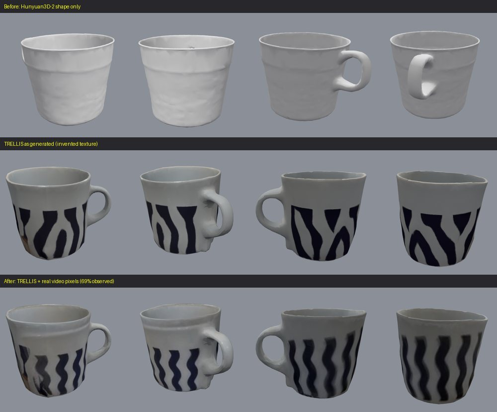

# WorldKit — Film reality. Build worlds. Run simulations.

**WorldKit's goal:** transform real-world video into editable 3D environments that people can inspect, modify, and eventually use to test scenarios.

This repository is a hackathon prototype, not a finished city simulator or engineering tool. The current verified milestone is a single-object pipeline demonstrated on a mug: Meta Muse Spark scene/object understanding and SAM 3.1 segmentation feed a reconstruction fallback that uses **Hunyuan3D-2 through a community-hosted Hugging Face Space**. That reconstruction backend is from Tencent's open-weights model family; it is **not a Meta model and not SAM 3D Objects**.

Built for the Meta Global AI Developer Hackathon 2026 (Indie Developer track, Push the Frontier theme). Build period: Oct 27–Nov 4, 2026. Submission deadline: Nov 4, 9:00 PM Eastern / Nov 5, 5:00 AM Riyadh.

## What exists now

- **Python object pipeline:** video frame extraction, Muse Spark object understanding with explicit-object override, SAM 3.1 segmentation, reconstruction backend selection, mesh print-prep, and preview rendering.
- **Reconstruction (no Modal needed):** `--mesh-backend trellis` produces a **textured** mug (TRELLIS, Microsoft -- not a Meta model) with real wall thickness and a handle loop, and `--project-frames N` then replaces the texture's *invented* colours with **real pixels from the source video** wherever the frames can see the surface (geometry is never modified; the unseen remainder stays generated and is reported). The earlier Hunyuan3D-2 backend (`--mesh-backend hosted`) only returns an untextured, paper-thin shell. See *Reconstruction quality* below.
- **Print-prep validation:** the textured mug is watertight with 0 of 1500 sampled points below the 1.2 mm wall threshold *at the assumed scale* (`geometry_checks_passed: true`), but it is **not reported print-ready**: no real height was measured, so its 10 cm size is an explicitly flagged placeholder (`print_ready` requires a measured `--height-cm`). The older Hunyuan3D shell fails the wall-thickness check outright.
- **Interactive, browser-verified viewer:** `viewer/index.html` (+ `viewer/server.py`, a small Flask backend) loads a GLB, orbits around it, applies a real object transform via a move/rotate/scale gizmo, exports/reloads the edited GLB, and optionally loads a run's `report.json`/source video for provenance. **Verified with 29 automated real-browser checks** (Playwright + Chromium, `viewer/tests/browser_test.js`) — not just committed, unverified source.
- **Real natural-language editing:** type an instruction like "move it 10 cm to the left" and it's interpreted by a real Muse Spark API call (`pipeline/worldkit/editcmd.py`), validated server-side (malformed/out-of-range responses are rejected before they can touch the model), and applied to the live object. The API key never reaches the browser. Manual gizmo editing works identically with or without a configured key.
- **A real, scoped collision-detection demo:** the viewer's collision probe uses genuine ray/triangle intersection tests (`THREE.Raycaster`) against the actual loaded mesh — it stops at real geometry rather than passing through. Not physics (no gravity/mass/forces), and scoped to the one reconstructed object, not a multi-object scene.
- **Verified as one product, not just as separate parts:** a real, fresh `python -m worldkit.object ... --mesh-backend hosted` run (video -> frames -> Muse Spark -> SAM 3.1 -> Hunyuan3D-2 -> print-prep) produced a genuine mesh and `report.json`, which was then loaded into the running viewer and driven through a full real edit sequence (AI edit -> manual gizmo edit on top of it -> collision probe against the edited model -> export -> reload) and the provenance panel, in one single automated integration test.
- **Automated tests:** 122/122 Python tests (`pytest`), 29/29 real-browser checks (`viewer/tests/browser_test.js`; includes a simulated-API-failure path and checks that the bundled sample is textured, dielectric and not near-black) and 11/11 end-to-end integration checks (`viewer/tests/integration_test.js`) -- 162 automated checks. Hosted-model tests mock the network call for determinism; the texture-projection tests use synthetic scenes with known ground truth and were mutation-checked. Real API calls (Muse Spark, SAM 3.1, the hosted Spaces) were made and verified separately.

## What is not yet implemented or verified

- Full multi-object or room/city reconstruction from video — the collision demo and viewer both operate on one reconstructed object.
- SAM 3D Objects inference: the Modal image builds, but Modal blocks A100 functions until a payment method is added. No payment method was added.
- Calibrated real-world scale — the current mesh's dimensions use an explicitly-flagged, unmeasured placeholder.
- Measured real-world scale, so no model is reported print-ready; engineering-grade geometry accuracy (**all geometry is generated**, including the entire unseen side -- only the *appearance* of observed surfaces comes from real pixels); or reliable export to Unity/Unreal/CAD.
- A live re-run of the productized `--mesh-backend trellis` call: the free daily GPU quota for the hosted Space was used up while developing it (it resets daily; a paid plan was deliberately not used). The CLI was verified end to end on the real video with the real TRELLIS GLB via `--mesh-backend import --project-frames 8`.
- Muse Wonder, VGGT, or Muse Image integration in the verified mug run.
- A deployed, production-ready web application, the planned `/app` Next.js PWA wrapper, or account/device sync — the viewer runs standalone via `viewer/server.py` today.

## Run the Python pipeline

From the repository root on Windows, using Python 3.10 and the environment in `pipeline/.venv`:

```powershell
pipeline\.venv\Scripts\python.exe -m worldkit.object "pipeline\samples\<video>" --out "pipeline\runs\<run-name>" --object "mug" --mesh-backend hosted
```

For a **textured** result (recommended while Modal is blocked), use the TRELLIS Space; it projects up to 8 real video frames onto the texture by default:

```powershell
pipeline\.venv\Scripts\python.exe -m worldkit.object "pipeline\samples\<video>" --out "pipeline\runs\<run-name>" --object "mug" --mesh-backend trellis
```

Use `--mesh-backend modal` only if Modal GPU execution is available and its cost has been explicitly approved. The hosted Spaces are third-party infrastructure on a small **free daily GPU quota** (an exhausted quota is reported as such, with the working alternative `--mesh-backend import`); they may also be unavailable, queued, or change their API. Pass `--height-cm <measured height>` to get a real (non-placeholder) scale.

To process a previously generated mesh without making a reconstruction request (add `--project-frames 8` to re-paint a textured GLB with real video pixels):

```powershell
pipeline\.venv\Scripts\python.exe -m worldkit.object "pipeline\samples\<video>" --out "pipeline\runs\<run-name>" --object "mug" --mesh-backend import --mesh-file "pipeline\runs\<run-name>\model.glb"
```

Inspect `report.json` for actual backend provenance, stage timings, warnings, and print-prep validation. Do not infer print readiness from watertightness alone.

## Open the interactive viewer

```powershell
pipeline\.venv\Scripts\python.exe viewer\server.py
```

Then open `http://127.0.0.1:5050/` (needs internet access — it loads three.js from a CDN). It loads the bundled `viewer/assets/sample_mug.glb` automatically; use "Load GLB" to pick a different local file, e.g. your own `pipeline/runs/.../model.glb`. Optionally load `report.json` and the source video in the provenance panel. Use the gizmo or the natural-language box to move/rotate/scale the model, enable the collision probe, and export an edited GLB.

The viewer edits the loaded object's transform, not its internal topology. The collision probe is real ray/triangle collision detection, not a physics simulation.

## Meta AI tooling and provenance

| Tool | Intended/verified role |
|---|---|
| Muse Spark (Meta Model API) | Scene/object understanding. A real call succeeded, but an unprompted sample misidentified the mug as a side table; an explicit object override is supported. |
| SAM 3.1 (Meta Model API) | Real mug segmentation including the handle; verified on the source frame. |
| SAM 3D Objects (Meta open weights) | Intended reconstruction route; not yet run because Modal requires a payment method for A100 functions. |
| TRELLIS (Microsoft open weights, hosted community Space) | Textured mug mesh backend. Not a Meta model; every report records the model and whether it is Meta's. |
| Hunyuan3D-2 (Tencent open weights, hosted community Space) | Earlier untextured shape-only backend (the baseline in *Reconstruction quality*). Not a Meta model. |
| Muse Wonder, VGGT, Muse Image | Future/optional integrations; do not claim they were used in the verified run. |

## Reconstruction quality



Same source video, same SAM 3.1 masks. Measured on **held-out frames** (frames none of the compared textures were built from; each texture gets the identical per-frame alignment, so this scores texture quality, not pose estimation):

| Mug texture | stripe correlation (NCC) | luminance error |
|---|---|---|
| TRELLIS as generated (invented) | 0.467 | 32.9 |
| + real video pixels, **8 frames given / 7 used** (frame 00 auto-rejected: handle hidden, azimuth unconstrained) | **0.915** | **10.3** |

70.8% of the surface was observed that way; the rest is generated. Also measured: TRELLIS's own multi-image mode was **not** better (it hallucinated a ground slab and scored no higher on held-out frames), so it is not used. Caveats: one object, one video; geometry is entirely generated (note the dent at the handle base and the smudged, least-observed side); weak-perspective poses from silhouettes plus stripe registration. Details and the bugs this uncovered are in `CLAUDE.md`.

## Judging-focused next milestones

See [the three-minute demo runbook](docs/DEMO_RUNBOOK.md) for the recording checklist, suggested narrative, rubric mapping, and milestone gates.

1. Calibrate real-world scale (A4 or coin reference) instead of today's unmeasured placeholder.
2. Re-run the productized `--mesh-backend trellis` call live once the free GPU quota resets, and pass a measured `--height-cm` so `print_ready` can actually be evaluated (the wall-thickness check already passes at the assumed scale).
3. Extend from one object to a real multi-object scene.
4. Package the viewer into the planned `/app` Next.js PWA wrapper.
5. Record a concise, truthful three-minute demo: source footage → genuine reconstruction → actual edit (gizmo + natural language) → collision demo → validation/export → broader vision. Report measured results only.

The hackathon judges impact (30%), Meta AI tooling (25%), technical execution (20%), and demo quality (25%). The priority is one complete, credible, *tested* workflow — not a list of unimplemented features.

## Repo structure

```
/pipeline Python AI pipeline (video -> mesh -> print-ready STL)
/viewer   Browser 3D viewer + editor (three.js + a small Flask backend)
/docs     Architecture notes, benchmark results, docs/DEMO_RUNBOOK.md
```

(`/app`, a Next.js PWA wrapping the viewer, is a planned next step — not built yet. The viewer runs standalone today via `viewer/server.py`.)

## License and author

See [LICENSE](LICENSE). Created by Abdullah Ali Alanazi ([@No6Name8](https://github.com/No6Name8)).
