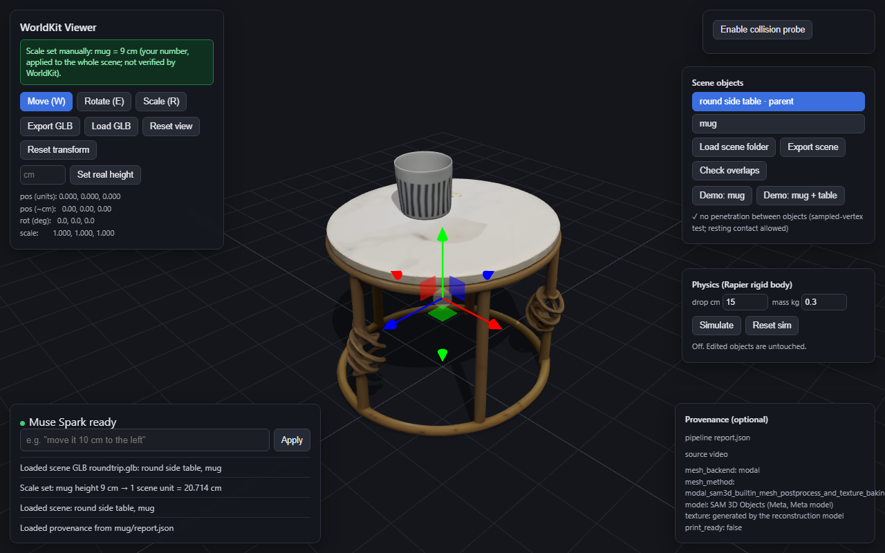
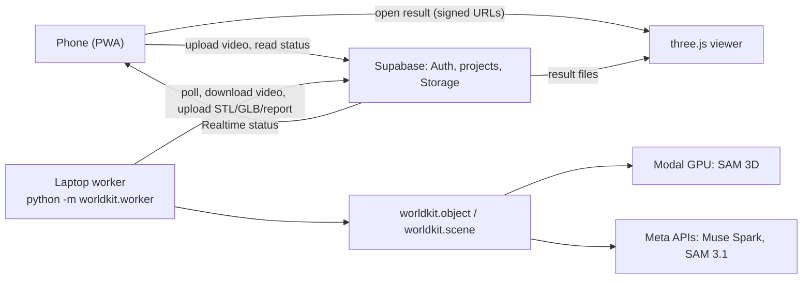

# WorldKit — Film it. Build it.

**WorldKit turns a phone video into editable 3D objects and scenes.** Film a mug on a table: WorldKit finds the objects with Meta's Muse Spark and SAM 3.1, rebuilds each as a textured 3D model with Meta's SAM 3D Objects, composes them into one scene, corrects what the video can prove (stripe pattern, scale from a reference object), and opens the result in a browser viewer where you can select and edit each object, ask Muse Spark to move things in plain language, drop objects under real rigid-body physics, and export the scene.

Built solo for the Meta Global AI Developer Hackathon 2026. This is a working prototype demonstrated on **one real video** (a striped mug on a round side table); see *Limitations* for exactly what that does and does not show.



## Try it in one minute (no GPU, no API key)

```powershell
cd pipeline
py -3.10 -m venv .venv
.venv\Scripts\python.exe -m pip install -r requirements.txt
cd ..
pipeline\.venv\Scripts\python.exe viewer\server.py
```

Open <http://127.0.0.1:5050/> and click **Demo: mug + table** (or **Demo: mug**). The bundled demo assets are real pipeline output; three.js and the physics engine are vendored, so this works offline. Select the mug or the table (click or list), move/rotate/scale each with the gizmo, **Check overlaps**, type the mug's real height in **Set real height** to calibrate, press **Simulate** to drop the mug on the table (Rapier physics), **Reset sim**, then **Export scene**. Natural-language editing ("move it 10 cm to the left") needs a Meta API key in `pipeline/.env`; everything else does not.

## Web app (phone upload) and laptop worker

**The web app never runs the pipeline.** It signs you in, uploads a phone video, shows each project's status live and opens finished results in the viewer. All the heavy work (SAM 3D on Modal, Meta API calls) runs on **your laptop**, in a worker you start yourself. Nothing is processed in the cloud.

What runs today:

- **Web app** (`web/`, Vite, no framework): home, sign in / sign up, new project (Object or Map, record or pick a video, upload with a progress bar), projects list with live status (Supabase Realtime, 8 s polling as fallback), delete, and the viewer for finished projects (private files opened through signed URLs). It is an installable PWA (app shell cached only; never videos). Works at 390 px and 1440 px.
- **Supabase** (`supabase/migrations/`): a `projects` table with Row Level Security (you only ever see your own rows), private `videos` and `results` buckets whose first folder must be your user id, Realtime on `projects`.
- **Laptop worker** (`python -m worldkit.worker`): signs in as you (publishable key, Row Level Security applies, no service key), takes the oldest `uploaded` project, downloads the video, runs `worldkit.object` or `worldkit.scene` with the coin `saudi-25-halalas`, uploads the STL, GLB and report, and sets `done` or `failed` with a plain sentence. `--dry-run` publishes a bundled run instead of running the pipeline, for testing without GPU or API cost.
- **Demo viewer** without an account: `/viewer/index.html?demo=1` (hosted) or the viewer server below.



Run it:

```powershell
# 1. database: push the repo (supabase/migrations) or paste supabase\RUN_THIS_IN_SQL_EDITOR.sql into the Supabase SQL editor
# 2. web app
cd web
copy .env.example .env.local        # fill VITE_SUPABASE_URL and VITE_SUPABASE_PUBLISHABLE_KEY (the publishable key, never the secret key)
npm install
npm run dev                         # http://localhost:5173
# 3. worker (a second terminal): the account you sign in with on the phone
#    put WORKER_EMAIL and WORKER_PASSWORD in pipeline\.env (gitignored), then:
cd ..\pipeline
.venv\Scripts\python.exe -m worldkit.worker --dry-run     # test chain, no GPU, no API
.venv\Scripts\python.exe -m worldkit.worker               # real runs (needs Modal and the Meta key, as above)
```

Deployment steps are in `docs/DEPLOY.md`. Limits: the free Supabase plan refuses single files over 50 MB (the app says so before uploading; film about 20 seconds); the hosted viewer has no edit server, so AI Edit needs `python -m worldkit.serve` on the laptop.

**Live: https://web-flame-psi-45.vercel.app** (sign in with an account on the Supabase project; processing still needs the laptop worker).

Verified against a real Supabase project with `node web/tests/e2e_real.mjs` (sign in, upload, live status, worker dry run, viewer, delete). The dry run publishes the demo mug, so that run shows the demo model, not the uploaded video. Screenshots: `docs/web/`.

Planned (not built): uploads over 50 MB (resumable), processing without a laptop, push notification when a project finishes, AI Edit from the hosted viewer, sharing a project with another account, a worker that subscribes instead of polling.

## Run it on your own video

```powershell
copy pipeline\.env.example pipeline\.env      # then put your Meta Model API key in MODEL_API_KEY
cd pipeline
.venv\Scripts\python.exe -m worldkit.object samples\mug_on_table.mp4 --out runs\my_mug --mesh-backend modal --fidelity auto
cd ..
pipeline\.venv\Scripts\python.exe viewer\server.py --open pipeline\runs\my_mug
```

- `--mesh-backend modal` (default) runs SAM 3D Objects on a Modal A100 (a few minutes, cents of GPU time). One-time setup: `modal setup`, a Modal secret `huggingface` with a token that has access to the gated `facebook/sam-3d-objects` weights, and a CPU preflight `modal run "modal_app/sam3d.py::check_env"` (see `pipeline/README.md`). Without a GPU use `--mesh-backend trellis` (a hosted community Space with a small free daily quota).
- `--fidelity auto` additionally measures stripe-like patterns from the frames and keeps them only if they beat the generated texture on held-out frames (details below). Off by default.
- `--ref-diameter-cm D` (a circular reference such as a coin, with its real diameter) or `--height-cm H` (a real measured height) give real-world scale. Without either, scale is a flagged placeholder and `print_ready` stays false.
- Several objects in one video: `python -m worldkit.scene VIDEO --out DIR --objects mug "round side table"`, then `viewer\server.py --open DIR`.
- Every run writes `report.json` (models used, what is observed vs generated, validation results, timings, warnings). Failures are written there too, with an actionable message.

## AI Edit: type an instruction, the model changes (verified, undoable)

```powershell
pipeline\.venv\Scripts\python.exe -m worldkit.edit pipeline
uns\my_mug "make it exactly 12 cm tall"
pipeline\.venv\Scripts\python.exe -m worldkit.edit pipeline
uns\my_mug --undo          # or --undo N, or --list
pipeline\.venv\Scripts\python.exe -m worldkit.serve pipeline
uns\my_mug               # viewer with the AI Edit chat panel, Undo and Download STL
```

Muse Wonder (`muse-wonder-1.0`, Meta Model API function calling) is shown the instruction and the model's measured facts and calls precise geometry tools on the print mesh (`worldkit/edit_tools.py`, trimesh + manifold3d): scale, emboss/engrave text, drill holes, flatten the base, split, thicken walls, mirror. Every result must pass deterministic checks (watertight, requested height, volume moved the right way) **and** Muse Spark judging before/after renders; a failure is fed back to Wonder for one retry, then the edit is rejected and the model is left untouched. Each applied edit is a version (`edits/v1.stl`, ...) with instruction, tool calls, verdict, token usage and timing in `edits/versions.json`; undo can go to any version and deletes nothing. STL versions are in millimetres, and the sizes are the model's own units: unless you supplied a measured height they are as uncalibrated as the rest of the scene.

Run live on the real mug (`pipeline/runs/edit_demo`): "add the text WORLDKIT on the base" (engraved, Spark: legible, 14 s), "make it exactly 12 cm tall" (101.6 mm to 120.0 mm, 11 s), "put a 5 mm hole through the handle side for a keychain" (through the handle bar centre along the ring-plane normal, Spark confirmed the hole in the close-up, 9 s), then undo back to v2. Each edit used roughly 3.5-4k Wonder and 1.7-2.1k Spark tokens; no price was looked up. Limits: the editor works on the untextured print mesh (the viewer shows the edited gray mesh), the print STL's own units are centimetres upstream (converted to mm for editing), and the verifier is a model looking at images, so small details can slip past it.

## How it works

`video -> frames -> Muse Spark names the object and picks the best frame -> SAM 3.1 masks it -> SAM 3D Objects builds a textured mesh -> [optional] Muse Spark analyses the frames, a stripe model is measured from them and accepted only if it wins on held-out frames -> scale from a reference or measurement -> print prep + previews -> viewer (select, edit, physics, export)`

| Meta technology | What it does here | Verified |
|---|---|---|
| Muse Spark (Meta Model API) | names the main object and picks the best frame (a 12-frame call returned "coffee mug"); structured analysis of the frames (category, rim, stripe type, count, region) that gates the fidelity stage; natural-language edits in the viewer, validated server-side | real calls |
| SAM 3.1 (Meta Model API) | segments the object (handle included), the coin reference and each scene object in every frame | real calls |
| SAM 3D Objects (Meta open weights, Modal A100) | reconstructs each object's textured mesh from one masked view | real GPU runs |
| Not used | Muse Wonder, Muse Image, VGGT | |

Non-Meta pieces, recorded as such in every report: TRELLIS (Microsoft, hosted Space) as a no-GPU fallback, Hunyuan3D-2 (Tencent) as an older baseline, Rapier (physics), three.js (viewer), trimesh/manifold3d (geometry).

## Results (all on the one mug video)

| | Result |
|---|---|
| Geometry | SAM 3D mug: watertight, single component, a real handle loop, level circular rim (rim plane within 0.9% of its radius, 0.26 deg from the base plane; upper outline within 1.4% of object height of the SAM masks in all 12 frames). The TRELLIS fallback is lumpier with an uneven rim. All geometry is generated, not measured. |
| Stripe texture | The generator draws near-straight stripes; the real mug has 14 wavy ones. 3-fold cross-validated held-out stripe correlation (every frame held out once): generated 0.68, existing UV pixel projection 0.80 (0.74-0.92 depending on fold), new cylindrical stripe model 0.84 (0.84-0.86 every fold). In the final model 37% of the surface is at observed angles, 3% is inferred from the measured stripe pattern, 61% (interior, rim, handle, base, unseen angles) is still generated. |
| Scene | Mug + table from one video, both SAM 3D; layout overlap with the real masks 0.83 overall (table 0.74, mug 0.89). The mug is assumed to rest on the table top. |
| Scale | Method validated on synthetic scenes with known sizes (mean error 3.7%, worst 11.5%); on the real video the coin gives a self-consistent estimate, **but the real coin and mug were never measured, so real-world accuracy is unverified.** |
| Physics | Rapier: gravity, mass, contacts; the table collides as its exact triangle mesh, the mug as a convex hull (handle opening filled in). Engine self-tests match 1/2 g t^2 within 1%. Not engineering accuracy. |

Side-by-side: `docs/fidelity_heldout_real_vs_baseline_vs_improved.png` (real frame, generated texture, improved texture at held-out views), `docs/fidelity_views_baseline_vs_improved.png`, `docs/sam3d_vs_trellis.png`. Full numbers, diagnosis and the experiments that did not work are in `docs/TECHNICAL_NOTES.md`.

## Limitations (read before judging)

- AI Edit changes only the print mesh: edited models lose the texture, and Muse Wonder is in preview (its tool-call quality and price may change).
- One object type (a mug) in one video; nothing here shows it generalises. The stripe model only handles periodic vertical stripes on bodies of revolution; per-stripe irregularities and gloss are not reproduced.
- All 3-D geometry, including every unseen side, is generated by the reconstruction model. Appearance is only "observed" where stated.
- Scale is a placeholder unless you provide a measured height or a reference diameter; a reference-based scale is an estimate and never makes a model print-ready. Scene objects use the generated texture (the fidelity stage runs in the single-object CLI only).
- Scenes: two objects demonstrated; the smaller one is assumed to rest on the larger one's top surface.
- Natural-language edits need a Meta API key and internet; the Modal path needs a Modal account with credits and access to the gated SAM 3D weights.
- Earlier SAM 3D texture numbers in this project's history were wrong (an evaluation helper reused another mesh's camera poses) and were corrected; see `docs/TECHNICAL_NOTES.md`.

## Tests

```powershell
pipeline\.venv\Scripts\python.exe -m pytest pipeline\tests          # Python tests (about 4 minutes)
cd viewer\tests; npm install; npx playwright install chromium; cd ..\..
pipeline\.venv\Scripts\python.exe viewer\server.py                   # in another terminal, for the browser suites
cd viewer\tests; npm run test:all
```

Hosted-model and Muse Spark calls are mocked in the Python tests; the browser suites run real Chromium against real reconstructed meshes (the Muse Spark edit checks make one real API call and need a key). `docs/DEMO_RUNBOOK.md` has the demo script and what each suite covers; `docs/SUBMISSION.md` has the project description.

## Repository

`pipeline/worldkit/` Python pipeline (CLI `object.py`, `scene.py`; `detect`, `segment`, `understand` for Muse Spark / SAM 3.1; `reconstruct`, `modal_app/sam3d.py` for reconstruction; `fidelity`, `cyl_texture`, `pattern_model`, `qc`, `mesh_qc` for the quality stage; `scale_cal`, `printprep`) · `viewer/` browser viewer, Flask server, vendored libraries, bundled demo assets, Playwright tests · `docs/` notes, runbook, comparison images · `CLAUDE.md` working notes for the coding agent.

Created by Abdullah Ali Alanazi ([@No6Name8](https://github.com/No6Name8)). See [LICENSE](LICENSE). Vendored: three.js (MIT), Rapier (Apache-2.0), in `viewer/vendor/`.
