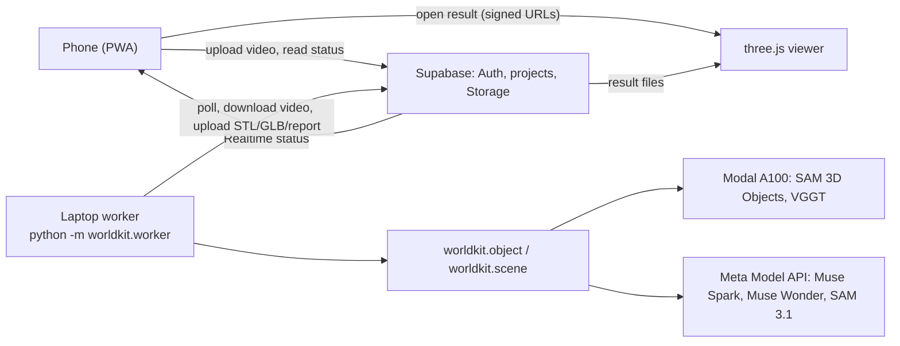

# WorldKit: Film it. Build it.

**WorldKit turns a short phone video of a real object into a 3D model at real size that you can inspect, edit by typing, and 3D print.**

## What it does (30 seconds)

You film an object next to a coin. Muse Spark names the object and picks the best frame. SAM 3.1 cuts it out in every frame, and SAM 3D Objects rebuilds it as a textured 3D mesh. The coin sets the real-world scale: on the one mug measured with a ruler, the model was within +1.9% (height), +3.7% (rim) and -1.9% (base). The result opens in a browser viewer, where you can type an edit ("make the handle 2 mm thicker"). Muse Wonder applies it with exact geometry tools, Muse Spark checks before/after renders, and every version can be undone. Download the STL in millimetres. Scene mode does the same for several objects on a desk and lays them out together at one scale.

**Live:** https://web-flame-psi-45.vercel.app. The demo viewer needs no account: https://web-flame-psi-45.vercel.app/viewer/index.html?demo=1. Uploads need an account, and processing runs on the author's laptop worker, not in the cloud.

## Built during the hackathon

Everything in this repository was built between Oct 26 and Nov 4, 2026 for the Meta Global AI Developer Hackathon 2026. The commit history is the evidence: the first commit (`e674b46`, 2026-10-26, "Project setup") contains only the README, CLAUDE.md, .gitignore and the license, and every feature arrives in later commits. Not written here: the models themselves and the vendored libraries in `viewer/vendor/` (three.js MIT, Rapier Apache-2.0) and `viewer/assets/fonts/` (Inter, IBM Plex Mono, OFL).

## Meta models used, and where each runs

| Model | What it does in WorldKit | Where it runs | Code |
|---|---|---|---|
| Muse Spark (`muse-spark-1.3`) | names the object and picks the best frame; structured frame analysis that gates the stripe-pattern stage; discovers the objects in a scene and proposes layout corrections; turns typed viewer moves into transforms; judges before/after renders of every AI Edit | Meta Model API (`https://api.meta.ai/v1`), called from the laptop | `detect.py`, `understand.py`, `mapmode.py`, `editcmd.py`, `edit.py` |
| Muse Wonder (`muse-wonder-1.0`, preview) | reads the edit instruction plus measured facts about the mesh and calls geometry tools (scale_to, emboss_text, drill_hole, flatten_base, split, thicken, mirror, thicken_part) | Meta Model API, function calling, called from the laptop | `edit.py`, `edit_tools.py` |
| SAM 3.1 (`sam-3.1`) | segments the object, the coin and each scene object in every frame; finds the mug handle for part edits | Meta Model API, called from the laptop | `segment.py`, `mapmode.py`, `parts.py` |
| SAM 3D Objects | reconstructs each object's textured mesh from one masked view | Meta open weights on a Modal A100-40GB | `modal_app/sam3d.py`, `reconstruct.py` |
| VGGT (VGGT-1B) | per-frame cameras for the scene verify step (silhouette IoU) and the per-object perspective correction in the card run; it does not build geometry | Meta open weights on a Modal A100 | `modal_app/vggt_probe.py`, `vggt_cams.py` |

Not Meta, and recorded as such in every report: TRELLIS (Microsoft, hosted Space) as a no-GPU fallback, trimesh and manifold3d (geometry), Rapier (physics), three.js (viewer), Supabase and Vercel (web app). Muse Image is not used.

## What is tested and what is unproven

**Tested (run for real, numbers measured):**

- **Scale vs a ruler:** one real mug, coin scale, Object mode: +1.9 / +3.7 / -1.9% (height, rim, base). All three tables are in [`docs/accuracy.md`](docs/accuracy.md).
- **Mug geometry:** the SAM 3D mug is watertight, has a real handle loop, and its rim plane is within 0.9% of its radius.
- **Stripe pattern:** the stripe-pattern model beat the generated texture on held-out frames (stripe correlation 0.84 vs 0.68).
- **AI Edit, run live with real Muse Wonder and Muse Spark** (`pipeline/runs/edit_demo`, `pipeline/runs/part_live`):
  - engraved text on the base
  - scaled the mug to exactly 120.0 mm
  - drilled a 5 mm hole
  - made the handle wall thicker, 6.9 to 9.4 mm, with the body unchanged (0.0 mm deviation)
  - undo
- **Web app:** with a real Supabase project, sign-in, upload, live status, a worker dry run and the viewer pass (`web/tests/e2e_real.mjs`, 19/19). The deployed site passes 8/8 (`web/tests/e2e_live.mjs`).
- **Automated tests:**
  - 243 Python tests, with network calls mocked
  - 8 browser suites on real reconstructed meshes (see *Tests*)

**Unproven:**

- **Other objects:** nothing shows the method works on anything but the one mug.
- **Hosted path:** the real pipeline has not been run through the hosted upload → worker path; only the dry run, which publishes the demo mug.
- **Scene placement:** layout uses a weak-perspective fit, not metrology.
- **Generated geometry:** every unseen side is generated by SAM 3D, not measured.
- **Physics:** convex-hull colliders, not engineering accuracy.

## Limitations

- **Card scale is not reliable.** The latest scene run used a bank card as the reference and missed by +16.9% (height), -8.8% (rim) and -12.3% (base). The causes:
  - The mug is about 65 px wide in the frames that show the card.
  - SAM 3.1 found the card in 0 of 12 frames, so a rectangle-detector fallback was used.
  - The perspective correction was tuned on this one run.

  It is a documented limitation ([`docs/accuracy.md`](docs/accuracy.md), table c).
- **One mug is the only evidence.** Every accuracy number comes from one physical mug. The +1.9 / +3.7 / -1.9% result is partly tuned by hindsight: the taper stage was added after seeing the base error, though it uses no ground truth.
- **Part edits work on the handle only.** `worldkit.parts` asks SAM 3.1 for one part, by default the mug handle, and `thicken_part` acts only on that part.
- **Scene edits have not been run live.** Per-object AI Edit in scene mode (`python -m worldkit.serve SCENE_DIR`) is covered by tests, but no live Muse Wonder edit has been run on a scene.
- **The hosted viewer has no AI Edit.** It has no edit server; AI Edit needs `python -m worldkit.serve` on the laptop.
- **Smaller limits:**
  - AI Edit works on the untextured print mesh, so edited versions lose the texture.
  - The coin size (21.5 mm) is looked up, not measured.
  - Print STLs include a thin base plate under the object (about 1.6 mm on the demo mug), so a slicer shows the plate plus the body.

## Try it in one minute (no GPU, no API key)

```powershell
cd pipeline
py -3.10 -m venv .venv
.venv\Scripts\python.exe -m pip install -r requirements.txt
cd ..
pipeline\.venv\Scripts\python.exe viewer\server.py
```

Open <http://127.0.0.1:5050/> and click **Demo run**: the coin-scaled mug (the headline run) in Object view, or the desk scene in Map view. Everything bundled is real pipeline output, and three.js and Rapier are vendored, so this works offline. In the Viewer tab you get mm dimensions, the scale source, "Show what SAM found" and Download STL (mm). The Accuracy tab shows the ruler comparison. AI Edit needs `python -m worldkit.serve RUN_DIR` and a Meta API key in `pipeline/.env`.

## Run it on your own video

```powershell
copy pipeline\.env.example pipeline\.env      # then put your Meta Model API key in MODEL_API_KEY
cd pipeline
.venv\Scripts\python.exe -m worldkit.object samples\mug_on_table.mp4 --out runs\my_mug --mesh-backend modal --ref-diameter-cm 2.15
cd ..
pipeline\.venv\Scripts\python.exe viewer\server.py --open pipeline\runs\my_mug
```

- **`--mesh-backend modal`** (the default) runs SAM 3D Objects on a Modal A100.
  - One-time setup: `modal setup`, then a Modal secret `huggingface` with a token that has access to the gated `facebook/sam-3d-objects` weights, then the CPU preflight `modal run "modal_app/sam3d.py::check_env"` (see `pipeline/README.md`).
  - Without a GPU, use `--mesh-backend trellis`.
- **Scale:** `--ref-diameter-cm D` (a coin of known diameter) or `--height-cm H` (a measured height). Without either, scale is a flagged placeholder and `print_ready` stays false.
- **`--fidelity auto`** measures stripe-like patterns and keeps them only if they win on held-out frames.
- **Scene mode:** `python -m worldkit.scene VIDEO --out DIR --coin saudi-25-halalas` (Muse Spark discovers the objects; add `--vggt` for VGGT verification), then `python -m worldkit.serve DIR`.
- **Reports:** every run writes `report.json` with the models used, what is observed vs generated, the scale source, timings and warnings.

## AI Edit

```powershell
pipeline\.venv\Scripts\python.exe -m worldkit.edit pipeline\runs\my_mug "make it exactly 12 cm tall"
pipeline\.venv\Scripts\python.exe -m worldkit.edit pipeline\runs\my_mug --undo     # or --undo N, or --list
pipeline\.venv\Scripts\python.exe -m worldkit.parts pipeline\runs\my_mug           # SAM 3.1 finds the handle, for part edits
pipeline\.venv\Scripts\python.exe -m worldkit.serve pipeline\runs\my_mug           # viewer with the AI Edit tab, Undo, Download STL
```

Muse Wonder gets the instruction and the mesh's measured facts and calls the geometry tools in `worldkit/edit_tools.py`. Every result must pass deterministic checks (watertight, requested size, volume moved the right way) **and** a Muse Spark review of before/after renders. On failure Wonder gets one retry; after that the edit is rejected and the model is left untouched. Each applied edit is a version (`edits/v1.stl`, ...) whose record in `edits/versions.json` holds the instruction, tool calls, verdict, token use and timing. Undo can go back to any version and never deletes anything.

## Web app (phone upload) and laptop worker

The web app never runs the pipeline. It signs you in, uploads a phone video to Supabase, shows each project's status live, and opens finished results in the viewer through signed URLs. The heavy work runs on a laptop worker (`python -m worldkit.worker`). The worker signs in with the publishable key, so Row Level Security applies and no service key is used. It runs `worldkit.object` or `worldkit.scene` and uploads the results. `--dry-run` publishes a bundled run instead, for testing without GPU or API cost. Setup and deployment: `docs/DEPLOY.md`.



## Tests

```powershell
pipeline\.venv\Scripts\python.exe -m pytest pipeline\tests          # Python tests (about 5 minutes)
pipeline\.venv\Scripts\python.exe viewer\server.py                   # in another terminal, for the browser suites
cd viewer\tests; npm install; npx playwright install chromium; npm run test:all
```

Meta API and Modal calls are mocked in the Python tests. The browser suites run real Chromium against real reconstructed meshes; a few checks make one real Muse Spark call and need a key. `web/tests/` has the web app's unit test, a mocked end-to-end test, the real-Supabase test and the live-site test.

## More

- [`docs/accuracy.md`](docs/accuracy.md): ruler comparisons
- [`docs/what_we_tried.md`](docs/what_we_tried.md): experiments that did not work
- [`docs/TECHNICAL_NOTES.md`](docs/TECHNICAL_NOTES.md): measurements and diagnosis
- [`docs/DEMO_SCRIPT.md`](docs/DEMO_SCRIPT.md): the 3-minute demo
- [`docs/SUBMISSION.md`](docs/SUBMISSION.md): submission text
- `CLAUDE.md`: working notes for the coding agent

Created by Abdullah Ali Alanazi ([@No6Name8](https://github.com/No6Name8)). MIT License, see [LICENSE](LICENSE).
