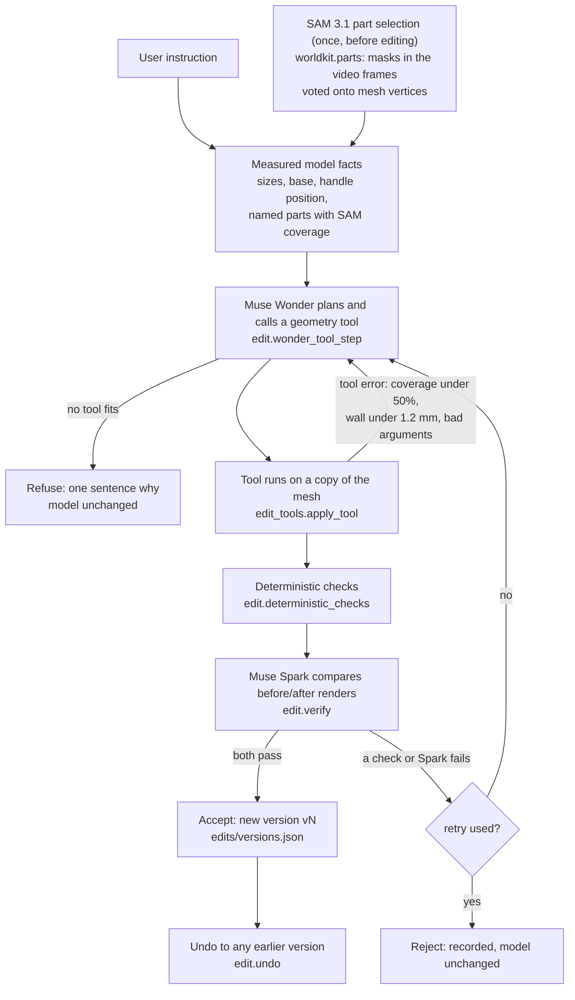

# The AI Edit agent

The AI Edit agent takes one plain-language instruction ("make the handle 2 mm thicker") and changes the 3D-print mesh of a reconstructed object. It picks the tool and its arguments, runs it, checks the result twice (geometry checks, then Muse Spark looking at renders), and then accepts, retries once, or refuses. Code: `pipeline/worldkit/edit.py` (`run_edit`), `pipeline/worldkit/edit_tools.py` (the tools), `pipeline/worldkit/parts.py` (SAM 3.1 part selection). Entry points: `python -m worldkit.edit RUN_DIR "instruction"` and the viewer's AI Edit panel (`python -m worldkit.serve RUN_DIR`).

## The loop

1. **Instruction.** The user types one instruction in the viewer or on the command line.
2. **Facts.** `edit_tools.model_facts` measures the current print mesh: size in mm, base plane, base floor thickness, the handle's position and plane normal, and the named parts with their SAM 3.1 coverage. These facts go to Muse Wonder as JSON with the instruction (`edit.run_edit`).
3. **Part selection (SAM 3.1).** Before any edit, `python -m worldkit.parts RUN_DIR` asks SAM 3.1 for "mug handle" in each video frame the run fitted, and votes the masks onto the mesh vertices (`parts.find_part`, `parts.vote_part`). On the mug run SAM 3.1 found the handle in 11 of 12 frames (`viewer/assets/demo/run_mug/parts/parts.json`). The selection is stored; an edit reuses it and makes no SAM call.
4. **Plan and tool choice (Muse Wonder).** `edit.wonder_tool_step` sends the instruction, the facts and the 8 tool schemas (`edit.TOOLS`) to `muse-wonder-1.0` with Chat Completions function calling. Wonder picks the tool and the arguments (for example the part id and `by_mm`, or the hole position from the handle facts). At most 6 Wonder turns per attempt (`MAX_TOOL_TURNS`).
5. **Tool.** `edit_tools.apply_tool` runs the tool on a copy of the current mesh. A tool error (for example "SAM found the handle in only 5 of 12 views") goes back to Wonder as the tool result, so Wonder can fix its arguments or stop.
6. **Deterministic checks** (`edit.deterministic_checks`): every edit must leave a watertight solid with positive volume and its base on z = 0. Per tool: `scale_to` must reach the requested height within 0.5%; `drill_hole` must remove material and not enlarge the model; `emboss_text` must change the volume in the right direction and, on the base, keep the outline and height; `flatten_base` must shave the requested depth.
7. **Visual check (Muse Spark).** `edit.verify` renders before and after from the views that matter for the tool (`edit._views_for`, for example a close-up of the handle) and asks `muse-spark-1.3` whether the after model shows what was asked and whether anything else changed. It answers in JSON.
8. **Decide.** Both checks pass: the mesh is saved as a new version. Either fails: Wonder gets the reasons and tries once more from the unedited model. A second failure is recorded under `rejected` in `versions.json` and the model is not changed.
9. **Undo.** `edit.undo` moves the current pointer to any earlier version. No version file is deleted.

## Where the agent decides alone

| Decision | Who decides | Where |
|---|---|---|
| Which tool, and its arguments (mm, part id, hole position and direction, text, face) | Muse Wonder | `edit.wonder_tool_step` |
| Which part an instruction names ("the handle") | Muse Wonder, from `named_parts` in the facts; the vertices of the part come from SAM 3.1 | `edit_tools.model_facts`, `parts.find_part` |
| How much when no amount is given ("make the handle thinner" became -2 mm) | Muse Wonder | `docs/agent_traces/edit_c.json` |
| Retry after a failed check, with the failure reasons | the loop, once | `edit.run_edit` (`retries=1`) |
| Refuse when no tool fits | Muse Wonder (calls no tool and says why) | `docs/agent_traces/refusal_wonder_declined.json` |

## Where it stops

| Limit | Value | Where |
|---|---|---|
| A part edit needs SAM 3.1 to have found the part in at least half of the frames | 50% (`MIN_PART_COVERAGE`) | `edit_tools.thicken_part` |
| A part is never thinned below a printable wall | 1.2 mm (`MIN_WALL_MM`) | `edit_tools.thicken_part`; `docs/agent_traces/refusal_wall_floor.json` |
| Retries | 1 | `edit.run_edit` |
| Wonder turns per attempt | 6 | `edit.MAX_TOOL_TURNS` |
| The original is never edited | v0 is a copy of `model_print.stl` in mm; every edit writes a new `edits/vN.stl` | `edit._load`, `edit.run_edit` |
| Every applied edit can be undone | to any earlier version | `edit.undo` |
| If Muse Spark is unavailable (no key, budget cap reached) | the edit is decided by the deterministic checks alone, and the record says `spark_verified: false` | `edit.run_edit` |

## Tools

All lengths are mm unless the argument says cm. Schemas: `edit.TOOLS`; implementations: `edit_tools.py`.

| Tool | Arguments | What it does |
|---|---|---|
| `scale_to` | `height_cm` or `factor` | uniform scale of the whole model |
| `emboss_text` | `text`, `face` (base, front), `depth_mm` (0.1-3, default 0.6), `mode` (raise, engrave) | engraves text into the underside or raises it on the front |
| `drill_hole` | `diameter_mm` (0.5-60), `position` [x,y,z], `direction`, `through`, `depth_mm` | cylindrical hole |
| `flatten_base` | `depth_mm` | shaves the underside flat |
| `split` | `axis`, `offset_mm`, `keep` (upper, lower) | plane cut, capped and watertight |
| `thicken` | `min_wall_mm` | grows walls thinner than the minimum |
| `thicken_part` | `part` (id from `named_parts`), `by_mm` (0.2 to 6, or -0.2 to -6) | thickens or thins one SAM-selected part; the rest of the model does not move |
| `mirror` | `axis` | mirrors the model |

## The five rehearsed edits

Real Muse Wonder and Muse Spark calls on the coin-scaled mug, 2026-11-03, through the viewer (`scripts/rehearse_edits.mjs`). Each instruction ran twice with Undo between runs; all 10 edits were accepted on the first attempt (0 retries). Seconds are the server's time for the whole edit, run 1 / run 2. Full traces of run 1: [agent_traces/](agent_traces/). Source table: [DEMO_EDITS.md](DEMO_EDITS.md).

| | Instruction | Tool Wonder chose | Result | Spark verdict (run 1) | Seconds |
|---|---|---|---|---|---|
| a | make the handle 2 mm thicker | `thicken_part` handle, +2 mm | handle wall 5.22 → 7.34 mm | accepted: "Close-up shows handle visibly wider while cup and saucer remain unchanged." | 19.6 / 18.4 |
| b | put a 5 mm hole through the handle side | `drill_hole` 5 mm, through, along the handle normal | through-hole, size unchanged | accepted: "Close-up shows a clear through-hole in the handle side with no other visible changes." | 19.0 / 15.1 |
| c | make the handle thinner | `thicken_part` handle, -2 mm | handle wall 5.22 → 3.16 mm | accepted: "Close-up shows handle narrower while cup and saucer look unchanged." | 20.0 / 33.6 |
| d | make it exactly 12 cm tall | `scale_to` height 12 cm | 72.9 → 120.0 mm tall | accepted: "After Z is 120 mm with proportional scaling and no shape change." | 18.1 / 17.2 |
| e | add the text WORLDKIT on the base | `emboss_text` "WORLDKIT", base | text engraved on the underside | accepted: "AFTER underside clearly shows WORLDKIT with no other visible changes." | 15.7 / 13.9 |

Spark calls the print base plate a "saucer"; it is the flat plate `printprep` adds under every print.

Refusals on record: [refusal_wonder_declined.json](agent_traces/refusal_wonder_declined.json) (real: Wonder called no tool for "make the handle thinner" when the tool could only thicken, 2026-11-02) and [refusal_wall_floor.json](agent_traces/refusal_wall_floor.json) (the tool refuses thinning the 5.22 mm handle by 4.5 mm, which would leave 0.7 mm; run locally on the real mesh without a model call). The rehearsal itself had no rejected edit, so no live retry or Spark rejection is on record.

## What the agent cannot do

- **One object at a time.** In Map mode each object is edited in its own folder (`worldkit.serve` with `?obj=`); there is no edit that moves or changes several objects, and no scene layout edit.
- **One named part.** SAM 3.1 part selection exists for the mug handle only (`parts.find_part` default "mug handle"). Other parts ("the rim", "the base edge") are not selectable; Wonder can only use whole-model tools for them.
- **Only the 8 tools.** No free-form sculpting, smoothing, colour or texture edits. An instruction outside the tools is refused with a sentence.
- **The verifier sees renders, not the real object.** Spark judges whether the after render matches the instruction; it does not know whether the result fits a real use.
- **Sizes are only as good as the scale.** Edits are in mm of the model, whose scale is estimated from a coin (see [accuracy.md](accuracy.md)).
- **The hosted demo replays.** Live editing needs the local edit server and a Meta API key; the hosted viewer plays the recorded rehearsal (`viewer/assets/demo/edit_replay/`).
