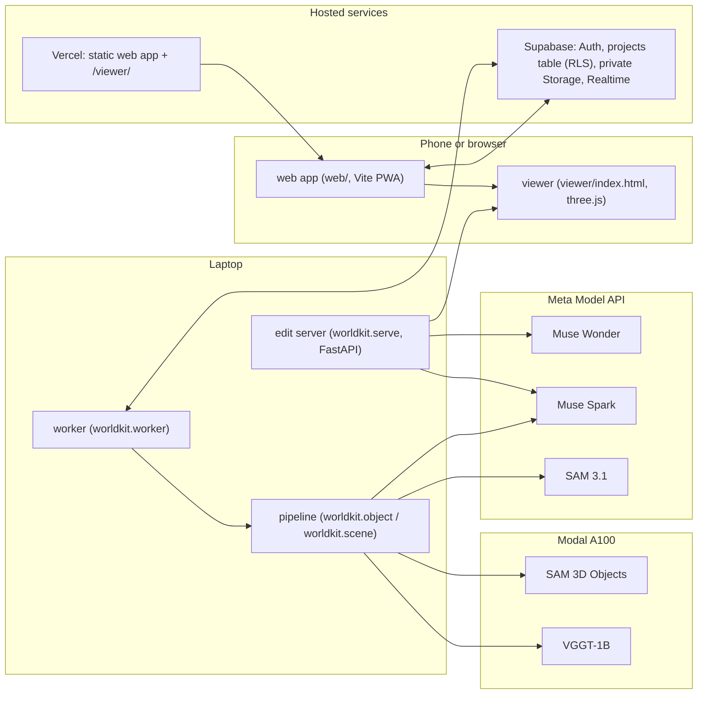
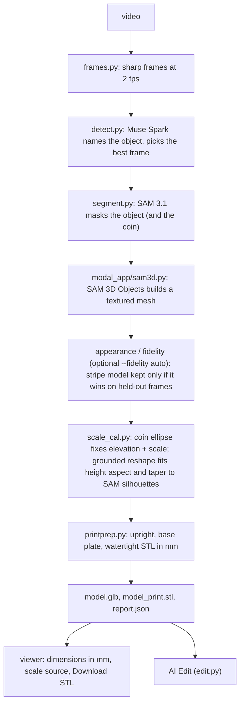
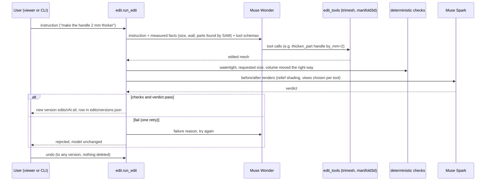
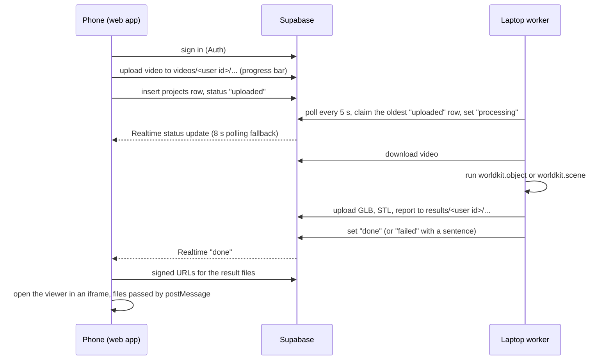

# Architecture

Four views of the system. File names are relative to the repo root.

## 1. System

The web app never runs the pipeline. Heavy work runs on the laptop, which calls the Meta Model API and Modal. AI Edit needs the local edit server; the hosted viewer has none.

## 2. Pipeline (Object mode, `pipeline/worldkit/object.py`)

Map mode (`mapmode.py`, `worldkit.scene` without `--objects`) runs these steps:

1. Muse Spark discovers the objects.
2. SAM 3.1 tracks each object across frames.
3. SAM 3D builds each object in parallel.
4. Mesh QC skips broken objects.
5. The scale reference (coin or card, `refscale.py`) places the objects at one scale.
6. A verify loop compares silhouettes from the original viewpoints, with weak-perspective cameras and optionally VGGT cameras. Muse Spark corrections are kept only if IoU improves.

## 3. AI Edit loop (`pipeline/worldkit/edit.py`, `edit_tools.py`)

## 4. Phone-to-laptop sync (`web/`, `supabase/`, `pipeline/worldkit/worker.py`)

Row Level Security limits every row and file to its owner. The worker signs in as a user with the publishable key; there is no service key anywhere.
