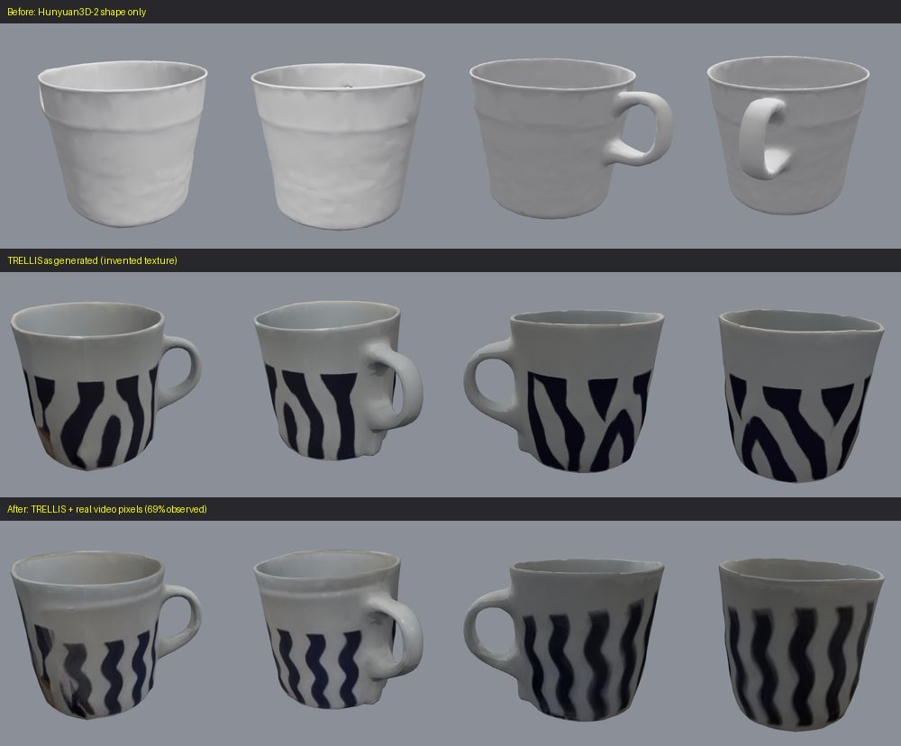
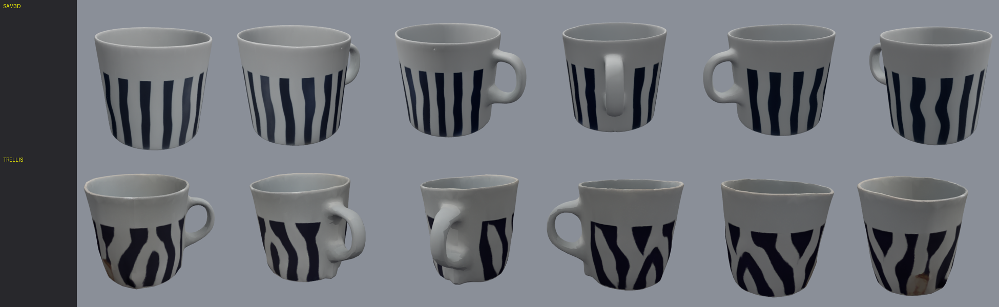
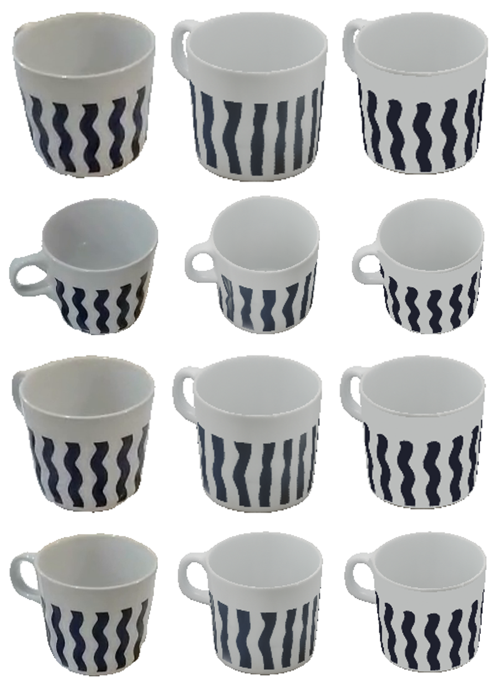

# WorldKit technical notes

Detailed measurements and design notes behind the README (moved here from the README so it can stay short). Everything below
was measured on the one real mug video in `pipeline/samples/`; none of it is claimed to generalise. Sections are in the order
they were produced; where a later section corrects an earlier one, it says so (see especially the retraction under *Texture*).

## Reconstruction quality

Same source video, same SAM 3.1 masks. Measured on **held-out frames** (frames none of the compared textures were built from; each texture gets the identical per-frame alignment, so this scores texture quality, not pose estimation):

| Mug texture | stripe correlation (NCC) | luminance error |
|---|---|---|
| TRELLIS as generated (invented) | 0.467 | 32.9 |
| + real video pixels, **8 frames given / 7 used** (frame 00 auto-rejected: handle hidden, azimuth unconstrained) | **0.915** | **10.3** |

70.8% of the surface was observed that way; the rest is generated. Also measured: TRELLIS's own multi-image mode was **not** better (it hallucinated a ground slab and scored no higher on held-out frames), so it is not used. Caveats: one object, one video; geometry is entirely generated (note the dent at the handle base and the smudged, least-observed side); weak-perspective poses from silhouettes plus stripe registration. Details and the bugs this uncovered are in `CLAUDE.md`.

## SAM 3D Objects result

`modal run modal_app/sam3d.py::main` (A100, 13 GB checkpoints cached on a Modal Volume) completes real inference. Measured on the same mug crop (`sharp_02`); geometry compared by eye and by mesh checks, not against ground truth:

| | SAM 3D Objects | TRELLIS (hosted Space) |
|---|---|---|
| faces / vertices (after merging UV seams) | 20,796 / 10,398 | 5,204 / 2,602 |
| watertight, single component, Euler number | yes, 1, 0 (a torus: a real handle loop) | yes, 1, 0 |
| handle | complete, smooth loop | complete but lumpy, with a dent at the base |
| texture | clean, even stripes | stripes warped, with a brown stain |

**Full CLI on the real video** (`--mesh-backend modal`, the default): frames, Muse Spark, SAM 3.1, SAM 3D, appearance finalize, print prep, previews. Fixed along the way: the CLI used to send SAM 3D the full 480x856 frame (mug ~110 px); it now sends the same 1024 px object crop the hosted backends use (`prepare_modal_input`), which produced visibly cleaner stripes (`pipeline/runs/sam3d_run4_e2e_crop/COMPARE_run3_vs_run4.png`). Result: reconstruct stage 138 s, watertight, 0/1500 thin-wall samples, `print_ready: false` only because the 10 cm height is still a placeholder.

**In the real viewer** (27 Playwright checks, `viewer/tests/sam3d_browser_test.js`): the pipeline's `model.glb` loads through the file input, is upright with the handle present, lit and dielectric; orbit/zoom/pan, gizmo drag, scale and reset leave the vertices intact; a real Muse Spark call moves it and manual editing still works after a simulated API outage; the collision probe passes cleanly through the handle opening at some aim points and is blocked by the handle bar and the body at others; export/reload keeps vertex count and texture; the provenance panel names SAM 3D Objects as a Meta model. The *raw* Modal GLB (not finalized) loads but renders dull (implicit metalness 1, no normals), so view the pipeline's `model.glb`, not the raw output.

**Real-pixel projection onto the SAM 3D mesh:** the numbers originally given here were produced with the wrong camera poses and are retracted; see *Reconstruction fidelity* below for the corrected, cross-validated comparison.

Getting here required fixing the Modal image (CUDA arch flags, nvdiffrast, the mip-splatting `diff_gaussian_rasterization`, `CONDA_PREFIX`, libGL, setuptools pin); `modal run "modal_app/sam3d.py::check_env"` (CPU) and `::gpu_smoke` (A100, no models) check those extensions before any full run. One object, one video: no generalization is claimed.

## Scale, scenes and physics (latest round)

**Capability table** (`Working` = runs end to end on real data; `Tested` = covered by automated tests with real-browser or real-model runs; `Partial`; `Not verified`; `Not implemented`):

| Capability | Status | Evidence / limit |
|---|---|---|
| SAM 3D Objects reconstruction (Modal A100), single object | Working | one mug, full CLI; `print_ready` false (no measured height) |
| TRELLIS fallback backend | Tested | unit + browser tests; no live Space call this round (free GPU quota) |
| Real-pixel texture projection onto SAM 3D | Tested | corrected 3-fold held-out stripe correlation 0.80 (varies 0.74-0.92 by fold) vs 0.68 generated; see *Reconstruction fidelity* |
| Scale from a coin (`--ref-diameter-cm`) | Tested | synthetic perspective scenes: mean 3.7% / max 11.5% error; on the real video the method runs and is self-consistent (0.4% spread over 4 frames) but **its real-world accuracy is Not verified** (no measured coin or mug) |
| Scale from a user-measured height (`--height-cm`, or the viewer's "Set real height") | Working | exact by construction; the number is the user's |
| A4-sheet scale (`estimate_height_cm_from_a4`) | Not verified | code exists; the video has no A4 sheet, so SAM 3.1 correctly finds none |
| `print_ready` | Working (conservative) | true only with a user-measured height plus passing geometry checks; reference-calibrated scale never qualifies |
| Multi-object scene from one video (mug + side table) | Working | real two-object run, real SAM 3D for both; layout is rough (IoU 0.83), assumes the child rests on the parent's top |
| Scene viewer: select, move/rotate/scale each object, overlap check, export/reload, missing-mesh handling | Tested | 50 real-browser checks on the real scene |
| Rigid-body physics (Rapier): gravity, mass, contact, settle, reset | Tested | 50-check browser suite incl. engine self-tests; mug collider is a convex hull (approximation) |
| Physical accuracy of the simulation | Not verified | sizes are physical only after calibration; hull colliders, no friction measurements |
| Muse Wonder / VGGT / Muse Image integration | Not implemented | |

### Texture: what was tried earlier (RETRACTED: these SAM 3D numbers used the TRELLIS mesh's camera poses; see *Reconstruction fidelity* for the corrected figures)

| Variant | NCC | MAE |
|---|---|---|
| SAM 3D as generated (default, preserved) | 0.427 | 48.7 |
| projection, 8 frames (earlier default) | 0.423 | 36.2 |
| 4 frames | 0.517 | 31.4 |
| **5 frames (best)** | **0.551** | 35.0 |
| 5 frames, winner-take-most blending (sharpness 8) | 0.369 | 38.9 |
| 5 frames, reject grazing views (cos < 0.45) | 0.460 | 37.1 |
| 5 frames, larger full-weight (0.35) | 0.531 | 35.6 |

Fewer frames helped; sharper per-texel selection and grazing-angle rejection made it worse. Likely cause (from visual comparison of renders, not measured): SAM 3D's stripes are straighter, narrower and more numerous than the real wavy ones, so registration and blending against them keep disagreeing. TRELLIS reached 0.915 with the same method, so the mismatch is in the generated texture. Decision: the generated SAM 3D texture stays the default; `--project-frames 5` is opt-in. Files: `pipeline/runs/texture_round2/` (variants, textures, log), `pipeline/runs/sam3d_run5_projected/`, `pipeline/runs/sam3d_run6_projected5/`.

### Scale calibration

`python -m worldkit.object ... --ref-diameter-cm D [--ref-concept coin]`: SAM 3.1 segments the reference in every kept frame, an ellipse is fitted (a circle's major axis is its diameter whatever the tilt), the object's pixels-per-mesh-unit comes from the silhouette pose fit, and `cm_per_unit = pose.scale / (major_px / D)` is taken per frame and combined by median (`worldkit/scale_cal.py`). WorldKit never guesses the coin: D is yours. The result is recorded as `height_source: reference_calibrated`, an estimate, so `print_ready` stays false.

- **Accuracy test (synthetic, true perspective, known sizes):** 18 camera/coin placements, 9 cm mug, 2.5 cm coin: mean absolute error 3.7%, worst 11.5% (camera 100 cm away, coin 12 cm to the side, only 4 usable frames). Error grows with camera distance and with the reference-object depth offset; `pipeline/runs/scale_validation/synthetic_sweep.json`.
- **Real video:** the coin is found in 4 of 12 frames; per-frame scales agree within 0.4% (a self-consistency figure, not accuracy), and the coin ellipse's implied camera elevation (32.5-36.3 deg) matches the independent pose-fit elevation (30-37 deg). With an ASSUMED 2.5 cm coin the mug would be 8.63 cm: that run (`pipeline/runs/scale_validation/real_video_plumbing/`) only proves the plumbing. **The real coin diameter and the mug's real height have not been measured, so real-world accuracy is not verified.** To verify: pass the coin's true diameter and `--height-cm <measured mug height>`; the report then records `cross_check_against_user_height.estimate_error_pct`.
- **Why A4 failed on this video:** there is no A4 sheet in it; SAM 3.1 correctly reports no mask. Reliability of A4 detection is untested.
- **Manual option:** the viewer's "Set real height" box (calibrates the whole scene from the selected object; the banner says it is your number). Scale changes units only, never proportions. A loaded `report.json` sets the scale only if its height and scale factor match the loaded model.

### Multi-object scene (exact workflow that passed)

`python -m worldkit.scene VIDEO --out DIR --objects mug "round side table" --mesh-backend modal` (`worldkit/scene.py`): extract frames; choose the sharpest frame where SAM 3.1 finds every object; subtract smaller objects' masks from larger ones; reconstruct each object with SAM 3D from its own crop (own `model.glb`, own `report.json`, own provenance); fit each object's camera pose in the shared frame; place the smaller object on the larger one's top plane (scale = px/unit ratio, yaw = azimuth difference, position = base-centre ray meets the top plane); write `scene.json` + `layout_check.png`. Real run: `pipeline/runs/scene_demo_mug_table/` (SAM 3D for both objects, 478 s, about $0.15 of metered GPU; layout IoU against the real masks: table 0.74, mug 0.89, both 0.83). Limits: layout is one frame's weak-perspective fit, the child must rest on the parent, scene units are arbitrary until calibrated, the table was reconstructed from a view that clips its edge.

In the viewer: "Load scene folder" (select the `scene.json` directory), click or list-select an object, move/rotate/scale it independently, "Check overlaps" (sampled-vertex inside-the-other-mesh test; resting contact is allowed), "Export scene" (one GLB with named nodes and provenance in glTF extras; reload restores both objects and their edited transforms), plain "Export GLB" exports only the selected object. A missing mesh is flagged, cannot be selected, and the rest still loads.

### Physics

Engine: Rapier 0.14 (WASM, loaded lazily from jsDelivr when Simulate is pressed; `viewer/physics.js`). Real: gravity 9.81 m/s^2, rigid-body dynamics, contacts, friction 0.6 / restitution 0.1, your mass input, CCD. The static parent (table) collides as its **exact triangle mesh**; a dynamic object collides as the **convex hull** of its mesh (the handle hole and hollow interior are filled in: a documented approximation, drawn as a cyan wireframe so collider and visual are distinguishable). The simulation runs on clones; originals are hidden and never moved, and Reset deletes the clones. A single object is dropped onto a ground plane at its lowest point.

Engine self-tests (own throw-away worlds): free fall within 1% of 1/2 g t^2; same impulse on 4x mass gives 1/4 velocity; collider half-height sets rest height. Scene tests (mug dropped 15 cm onto the table): 10-step fall within 3% of 1/2 g t^2; settles with the hull within 5 mm of the table's top surface; edited transforms untouched during and after; Reset restores exact transforms; a second run reaches the same resting position (< 1e-3); starting in contact neither sinks nor launches. A mug dropped 15 cm onto the bare ground plane tumbles onto its side before settling (physically plausible for a hull; not tuned). **Not claimed:** engineering accuracy; sizes are physical only if the scene is calibrated (the panel says so otherwise).

## Reconstruction fidelity (latest round)

**Correction first.** Earlier SAM 3D texture numbers in this README's history (0.427 / 0.423 / 0.517 / 0.551 stripe correlation, "projection gives ghosting and no gain on SAM 3D") were **wrong**: the evaluation helper `eval_projection.get_views` keys its pose cache by `sys.argv`, so every SAM 3D evaluation silently reused the TRELLIS mesh's camera poses. Re-measured with poses fitted to the SAM 3D mesh itself, the generated texture scores much higher and real-pixel projection does work on SAM 3D. Do not rely on the old SAM 3D texture figures.

**What was measured** (real mug video, `pipeline/runs/fidelity_round1/`, 3-fold cross-validation: every one of the 12 frames is held out once and every candidate only sees the other 8; each frame's pose is re-aligned photometrically against the texture being judged, identically for all candidates):

| Texture | held-out stripe correlation | stripe-mask IoU | luminance error |
|---|---|---|---|
| Generated by SAM 3D (baseline, kept as the default) | 0.679 | 0.530 | 34.1 |
| Existing UV real-pixel projection, 8 views | 0.804 (0.92 on one fold, 0.74-0.75 on the other two) | 0.712 | 14.0 |
| **Cylindrical stripe model (new)** | **0.844 (0.84-0.86 on every fold)** | **0.758** | 31.7 |

The stripe model wins on stripe shape and is stable across folds; UV projection wins on luminance error (it copies lighting along with the pixels) and varies a lot with which viewpoints are held out. Neither measures 3-D shape. The luminance error of the stripe model is not an improvement claim: its albedo is a two-colour pattern whose white level is taken from the generated body colour, not from a photo's exposure.

**Diagnosis (what was actually wrong)**
- *Stripes*: the generator draws 14 near-straight stripes where the real mug has 14 wavy ones (spacing 26 degrees, CV 3-6%, wave amplitude about 7 degrees, stripes cover the lower ~70% of the body). The old UV projection then fought this: silhouette-only camera poses had **elevations off by up to 30 degrees** (56 -> 26 on one frame) because a silhouette barely constrains elevation, which stretched everything vertically; the body radius was biased 2-3% low by the cup's inner wall, which shifts each view's unwrapped columns by a few degrees; per-texel blending of slightly disagreeing frames in a many-chart UV atlas gives the ghosting/halftone patterns; and registering a *periodic* pattern by correlation aliases onto neighbouring stripes unless shifts are bounded and penalised.
- *Rim*: **not reproduced for SAM 3D.** Measured on the benchmark mesh: rim plane planarity 0.87% of the rim radius, circularity 1.0%, rim plane vs base plane 0.26 degrees, body axis 0.17 degrees from +Y. The mesh's upper outline matches the SAM mask in all 12 real frames within 1.4% of the object height on average (max 1.9%, a couple of pixels). The uneven rim visible on the *TRELLIS* output and in earlier TRELLIS renders is a TRELLIS defect; no rim correction is justified for the SAM 3D mesh and none is applied to it. Axis tilts of 1.2-3.0 degrees on other real meshes (raw SAM 3D crop, the scene mug, TRELLIS) are corrected by a rigid rotation that changes no edge length (tilt to <= 0.6 degrees, `runs/fidelity_round1/geometry_qc_real_meshes.json`). Rim levelling is implemented and unit-tested on synthetic wavy rims but has not fired on any real mesh.

**What was implemented** (all opt-in, `--fidelity auto`; the default CLI behaviour is unchanged)
- `worldkit/understand.py`: one Muse Spark call returns structured observations (category, body of revolution, handle, rim shape/level, stripe type/shape/count/region, with confidences). On the mug it said: mug (0.97), circular level rim, wavy vertical stripes, about 12 stripes, stripes up to 65% of the body. It is **used** to decide whether the stripe model may be attempted and whether a rim constraint is permitted; its stripe count (12) and region are cross-checked against the measurement (14, 72%) and the measurement wins when they disagree by more than 25%/0.25. It is never accepted as proof.
- `worldkit/mesh_qc.py`: rim/base/axis measurement (handle masked by azimuth, axis from the rim and base plane normals), a gated rigid axis alignment, a gated rim levelling.
- `worldkit/cyl_texture.py`: pose refinement against the generated texture, unwrapping each frame into (angle, height) around the body axis, registration by bounded, penalised 2-D shifts, fusion in that seam-free domain, resampling back into the UV atlas.
- `worldkit/pattern_model.py`: measures the stripe lattice, count, canonical waveform and extent from many stripes at once; **refuses** (and the plain fused observations or the original are kept) when spacing is irregular, no whole stripe count fits, or too few complete stripes were seen.
- `worldkit/qc.py` + `worldkit/fidelity.py`: the quality-control loop. A candidate built from a subset of frames must beat the generated texture on the frames held out of its construction by explicit margins (>= +0.03 stripe correlation and >= +0.03 stripe IoU, and no single frame losing more than 0.10), otherwise the original is returned unchanged. On the real mug: held-out correlation 0.719 -> 0.846, stripe IoU 0.569 -> 0.762, accepted, then rebuilt from all frames. The report (`report.json` -> `fidelity`) records every decision, the per-frame numbers, the registration shifts and the observed / inferred / generated split.

**Result on the mug** (`pipeline/runs/sam3d_run7_fidelity/`, full CLI with `--fidelity auto --mesh-backend import` of the SAM 3D mesh; geometry unchanged): 37% of the surface is body texels at angles the video saw (their pattern parameters measured from real frames), 3% is filled from the measured stripe lattice at unseen angles (marked inferred), 61% (interior, rim, handle, base, unseen sides) keeps SAM 3D's generated texture. The viewer's provenance panel shows the decision and the held-out numbers. Side-by-side views: `docs/images/fidelity_views_baseline_vs_improved.png`.

**Remaining limits.** Only vertical periodic stripes on bodies of revolution are modelled, on one object from one video; per-stripe irregularities of the real print are not reproduced (stripes are the measured canonical shape, ends slightly rounded); the albedo is flat two-colour (no gloss, no print texture); the stripe count (14) comes from a measurement over about 9 observed stripes and has not been checked by physically counting; the angular gauge between viewpoint clusters comes from silhouette poses only; handle, interior, base and unseen angles are still generated. All geometry is still generated.

