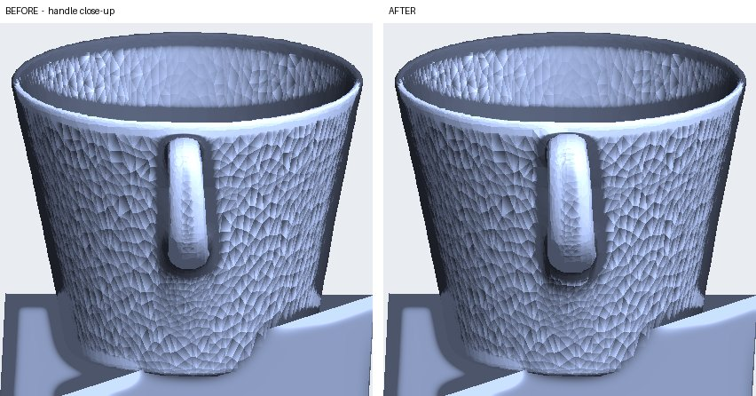
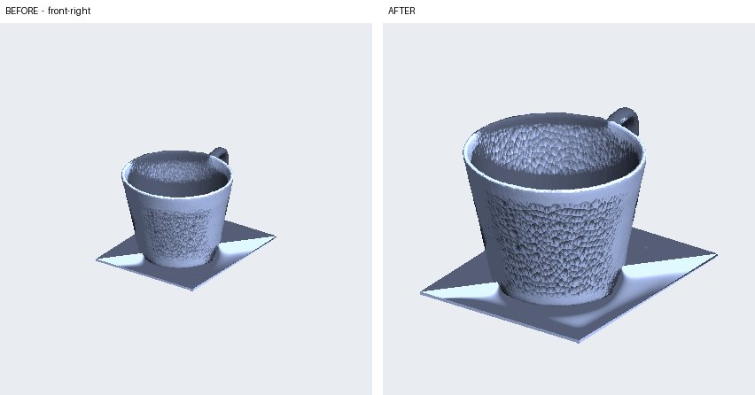
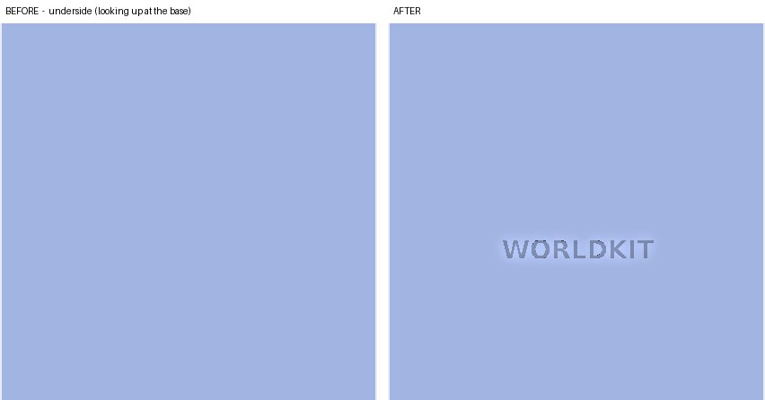

# Muse Wonder as the editing engine

## What it does here

Muse Wonder (`muse-wonder-1.0`, Meta Model API) turns a typed instruction into calls to geometry tools. It never touches the mesh itself: it reads the instruction and the measured facts of the model, then calls one or more of the 8 tools in `edit.TOOLS` with exact arguments. The tools run deterministically in `edit_tools.py`. The full loop, with its checks and limits, is in [AGENTIC.md](AGENTIC.md).

Code that calls it: `pipeline/worldkit/edit.py`, function `wonder_tool_step` (the request is `client.chat.completions.create(model=WONDER_MODEL, messages=messages, tools=TOOLS, max_tokens=16000)`), called from `run_edit`. The client is `meta_api.get_client()` (OpenAI SDK, base URL `https://api.meta.ai/v1`, key `MODEL_API_KEY` from `pipeline/.env`). Live use: `python -m worldkit.edit RUN_DIR "instruction"`, or the AI Edit panel served by `python -m worldkit.serve RUN_DIR`.

## Why this model for the job

The job is turning plain language into a structured tool call with the right numbers. In the stored runs Wonder did that without any hand-written parsing:

| Instruction | What Wonder had to work out | Call it made | Trace |
|---|---|---|---|
| make the handle 2 mm thicker | the part id from `named_parts`, an amount in mm | `thicken_part(part="handle", by_mm=2.0)` | [edit_a.json](agent_traces/edit_a.json) |
| put a 5 mm hole through the handle side | a 3D position and direction from the handle facts (`bar_center_point_mm`, `plane_normal`) | `drill_hole(diameter_mm=5, position=[-1.66, 53.13, 60.62], direction=[-0.9998, -0.0187, 0], through=true)` | [edit_b.json](agent_traces/edit_b.json) |
| make the handle thinner | the sign and a default amount, with no number given | `thicken_part(part="handle", by_mm=-2.0)` | [edit_c.json](agent_traces/edit_c.json) |
| make it exactly 12 cm tall | the unit: the tool takes cm, the model facts are in mm | `scale_to(height_cm=12)` | [edit_d.json](agent_traces/edit_d.json) |
| add the text WORLDKIT on the base | which face, keeping the base flat | `emboss_text(text="WORLDKIT", face="base")` | [edit_e.json](agent_traces/edit_e.json) |

All 10 rehearsed edits (each instruction twice) produced a valid call on the first attempt ([DEMO_EDITS.md](DEMO_EDITS.md)). Each edit used 4,223 to 4,463 Wonder tokens, of which 182 to 354 were reasoning tokens (the `tokens` field of each trace). When no tool fitted, Wonder called nothing and answered in one sentence ([refusal_wonder_declined.json](agent_traces/refusal_wonder_declined.json)).

## Three examples

Each image is the verifier's own render: the same camera before (left) and after (right). These are the images Muse Spark judged.

**a. "make the handle 2 mm thicker"**: `thicken_part(handle, +2 mm)`; handle wall 5.22 → 7.34 mm, the rest of the mesh unchanged.

**d. "make it exactly 12 cm tall"**: `scale_to(height_cm=12)`; print mesh 72.9 → 120.0 mm tall, uniform.

**e. "add the text WORLDKIT on the base"**: `emboss_text("WORLDKIT", base)`; engraved into the underside so the base stays flat.

## How its output is checked

1. **Arguments.** Tool arguments arrive as JSON; a call whose arguments do not parse, or whose tool raises (`edit_tools.EditError`: out-of-range diameter, unknown part, SAM coverage under 50%, a wall under 1.2 mm), is returned to Wonder as the tool result and is not applied (`wonder_tool_step`).
2. **Output length.** A reply cut off by the token limit (`finish_reason=length`) stops the edit with an error instead of using a partial answer.
3. **Geometry.** `edit.deterministic_checks`: watertight, base on z = 0, and per-tool checks (requested height within 0.5%, a hole removes material, engraved text keeps the outline).
4. **Pictures.** Muse Spark compares before/after renders (`edit.verify`). Optional second verifier: Muse Spark Open on Baseten (`--spark-backend baseten`, see [MODELS.md](MODELS.md)).
5. **One retry, then refusal.** A failed check goes back to Wonder once with the reasons; a second failure leaves the model unchanged.

## Limits

- **Preview model.** `muse-wonder-1.0` is used as documented for the preview (comment at `edit.WONDER_MODEL`); its behaviour may change.
- **Pricing.** Not verified in this repo. The API returns token counts, which are stored per edit; no dollar cost is computed (`cost.usd` is null).
- **No image generation.** Wonder is used only for function calling over geometry tools. Muse Image is not used.
- **Reasoning tokens.** It reasons before calling a tool, so the request allows `max_tokens=16000`; a reply cut off by the limit stops the edit (`finish_reason=length` check in `wonder_tool_step`).
- **It only knows the tools.** It cannot invent a new operation; an instruction outside the 8 tools is refused.
